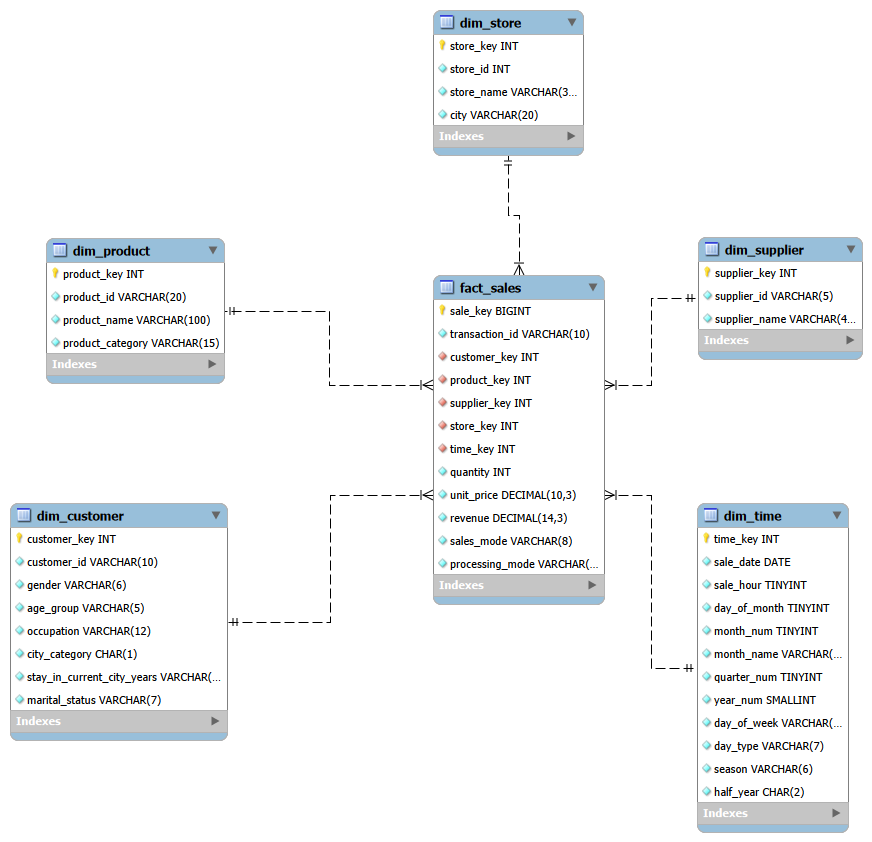

# Retail Data Warehouse with a MESHJOIN ETL

A near-real-time and periodic data warehouse for a simulated retail chain. Online sales arrive as a
live stream, store sales arrive as hourly batches, and both are enriched against customer and product
master data with the **MESHJOIN** stream–relation join before being loaded into a MySQL star schema.
Twenty OLAP queries then answer business questions over the warehouse.

**Stack:** Python (threads, pandas) · MySQL 8 (star schema, window functions, `WITH`, `ROLLUP`, views)

- **Data preparation**: cleans the UCI Online Retail file (541,909 → 397,884 transactions), splits carts
  into online/periodic sales with deterministic MD5 rules, and derives customer and product master data.
- **MESHJOIN**: a stream buffer, hash table and queue joined against master data read in disk-buffer
  partitions, running in its own thread alongside an online-stream thread and a periodic-batch thread.
- **Load shedding**: in peak time, periodic transactions that don't fit the stream buffer are written to a
  shed table and replayed in non-peak time; live transactions always take priority.
- **Interactive control**: switch arrival modes (`online` / `periodic` / `both`, `peak` / `non-peak`) and
  inspect buffer state while the pipeline runs.
- **Star schema**: `fact_sales` with customer, product, supplier, store and time dimensions, plus 20 OLAP
  queries including a `STORE_QUARTERLY_SALES` view.



> **Context.** Built for the DS3003/DS3004 Data Warehousing & Business Intelligence project at FAST-NUCES
> (Fall 2026). The raw dataset is not included in this repository; see section 2.


## 1. Repository layout

| Folder | Contents |
|---|---|
| `Create-DW` | `create_dw.sql` - drops any old copy and creates the working tables and the star schema |
| `Mesh-Join` | The Python project: `main.py`, `data_prep.py`, `rules.py`, `meshjoin.py`, `loader.py`, `sources.py`, `control.py`, `db.py`, `config.py`, `requirements.txt` |
| `Queries-DW` | `queries_dw.sql` - the 20 OLAP queries, including the view `STORE_QUARTERLY_SALES` |
| `Data` | `data_note.txt` (source, cleaning counts, derivation rules). Put `Online Retail.xlsx` here; the csv files are generated on the first run |
| `docs` | Star schema diagram and run screenshots |

What each Python file does:

| File | Job |
|---|---|
| `main.py` | Start of the program: asks for the connection details, runs the steps, reads the commands |
| `data_prep.py` | Reads and cleans the transactional file, builds the Master Data, writes the online file, loads the 48 periodic groups |
| `rules.py` | The fixed MD5 rules (sales mode, store, customer and product attributes) |
| `meshjoin.py` | Stream buffer, hash table H, queue, disk buffer, `MeshJoinThread` and the load shedding |
| `sources.py` | `OnlineThread` and `PeriodicThread` |
| `loader.py` | Data consolidation (revenue, store, time) and loading into the DW |
| `control.py` | State shared by the threads and the commands |
| `db.py` | MySQL helper functions |
| `config.py` | The fixed settings (partition 500, chunk 500, buffer 1000, speeds, hour length) |


## 2. What you need

- MySQL Server 8.0 or later (the queries use window functions, `WITH` and `ROLLUP`)
- MySQL Workbench, to run the two SQL scripts
- Python 3.10 or later
- The Python packages listed in `Mesh-Join/requirements.txt`:

```
pip install -r requirements.txt
```

- The raw transactional file `Online Retail.xlsx` from
  https://archive.ics.uci.edu/dataset/352/online+retail
  Put it in the `Data` folder, next to the csv files. If it is somewhere else,
  give its path with the `--raw` option (see section 5).

The MySQL user must be allowed to create a database and tables.


## 3. Create the database

There are two ways. Either one is enough.

**A. Let the program do it (the normal way).** Step 1 of the program creates
the database if it does not exist and then runs `Create-DW/create_dw.sql`.
Nothing has to be done by hand.

**B. By hand in MySQL Workbench.** Open `Create-DW/create_dw.sql` and run the
whole script. It creates the database `retail_dw`, removes any old copy of
the tables and of the view `STORE_QUARTERLY_SALES`, and creates:

- working tables: `customer_master_data`, `product_master_data`,
  `periodic_sales_data` (staging), `shed_table`
- star schema: `dim_customer`, `dim_product`, `dim_supplier`, `dim_store`,
  `dim_time` and the fact table `fact_sales`

The script can be run again at any time. It always starts from empty tables.


## 4. Start the program (this also prepares the data)

Open a terminal in the `Mesh-Join` folder and run:

```
python main.py
```

The program asks for the connection details. Press Enter to keep the value
shown in the brackets.

```
Host [localhost]:
Port [3306]:
Database name [retail_dw]:
User name [root]:
Password:
Path of the online file [...\Data\online_sales_stream.csv]:
```

The password is typed at run time. It is not written anywhere in the code.

Then the program works through the steps by itself:

1. **Step 1** - creates the working tables and the DW (old copies are dropped).
2. **Step 2** - prepares the data. This takes about one minute, most of it
   reading the Excel file.
   - reads `Online Retail.xlsx` and cleans it, printing the number of
     transactions before and after cleaning
   - marks every shopping cart Online or Periodic with the MD5 rule
   - builds the customer and product Master Data and loads them into MySQL
   - writes `online_sales_stream.csv` and the two Master Data csv files
   - sorts the periodic transactions by time, cuts them into 48 groups and
     loads them into the staging table `periodic_sales_data`
3. **Step 3** - prints the settings and starts `OnlineThread`,
   `MeshJoinThread` and `PeriodicThread`.
4. **Step 4** - the joined transactions are loaded into the DW while the
   threads run.
5. **Step 5** - the program waits for commands until `quit`.

When every transaction is in the DW the program prints a line that starts
with `[DONE]`. After that, type `quit`.


## 5. Options on the command line

All options are optional.

| Option | Meaning | Default |
|---|---|---|
| `--peak N` | Online transactions per second in peak time | 80 |
| `--non-peak N` | Online transactions per second in non-peak time | 10 |
| `--hour-seconds N` | Real seconds that make one simulated hour | 60 |
| `--start peak` or `--start non-peak` | Arrival mode at startup | peak |
| `--raw PATH` | Path of `Online Retail.xlsx` | `Data/Online Retail.xlsx` |
| `--schema PATH` | Path of `create_dw.sql` | `Create-DW/create_dw.sql` |
| `--skip-prep` | Skip steps 1 and 2 and reuse the data prepared by an earlier run. The DW and the shed table are emptied and all 48 groups are marked as not released. | off |

Examples:

```
python main.py --peak 80 --non-peak 10 --hour-seconds 60
```

```
python main.py --skip-prep
```

**Time scale.** One simulated hour is 60 seconds of real time. The program
prints this at startup. If `--hour-seconds` is given, the printed value
changes with it.


## 6. Commands while the program is running

Type a command and press Enter. The program keeps running while you type.

| Command | What it does |
|---|---|
| `online` | Online form only. Periodic groups are not extracted. |
| `periodic` | Periodic groups only. The stream reader is paused. |
| `both` | Both forms. Live transactions are taken first. |
| `peak` | Fast speed. Periodic transactions may be shed to disk. |
| `non-peak` | Slow speed. Shed transactions are read back and processed. |
| `peak N` / `non-peak N` | The same, and also changes that speed to N transactions per second. |
| `status` | Prints the mode, the speed, the stream-buffer count, the number of transactions in H, and how many transactions are still on the shed disk. |
| `help` | Lists the commands. |
| `quit` | Stops the threads and closes the program. |

After every switch, type `status` to see that it worked.

A short demonstration:

1. Start the program. It begins in `both` + `peak`. The first periodic group
   is extracted at once: about 1,000 transactions fit in the stream buffer
   and the rest go to `shed_table`.
2. Type `status`. "Shed disk" shows the transactions waiting on disk.
3. Type `non-peak`. The shed transactions are read back, and `status` shows
   "Shed disk: 0" a moment later.
4. Type `online`, wait for the next hour, and type `status`: no new group
   was extracted.
5. Type `both` to continue, and `quit` to stop.


## 7. How the load works

- **Priority.** A chunk is filled with Live (online) transactions first,
  then periodic transactions, and last with shed transactions.
- **Shedding.** A periodic group has about 2,480 transactions and the stream
  buffer holds 1,000. In peak time the part that does not fit is written to
  `shed_table`. In non-peak time the group waits for room instead, and free
  space in a chunk is filled from `shed_table`.
- **Loading into the DW.** Live results are inserted **directly into the
  fact table** as soon as they leave MESHJOIN. Periodic results are loaded
  together once every simulated hour. The bonus cache table is not used.
- **Dimensions.** If a customer, product, supplier, store or time value is
  not in its dimension table yet, it is inserted there before the fact tuple.


## 8. Run the OLAP queries

Run the queries after the program has printed `[DONE]`.

1. Open `Queries-DW/queries_dw.sql` in MySQL Workbench.
2. In the toolbar, change "Limit to 1000 rows" to "Don't Limit". Some
   queries return more than 1,000 rows, and the grand total of Q17 is the
   last row of its result.
3. Run the whole script. Each query opens its own result tab. The whole
   script takes about one minute.

Notes:

- The script starts with `USE retail_dw;`. If another database name was
  typed at startup, change that line.
- Q16 raises `tmp_table_size` for its own session so that it finishes in
  about 10 seconds, and sets it back afterwards.
- Q20 creates the view `STORE_QUARTERLY_SALES` and then reads it with
  `ORDER BY store_name, year, quarter`.
- The dates used by each query are written in the comment above it. The DW
  holds 1 December 2010 to 9 December 2011, so "the year" is 2011.


## 9. If something goes wrong

| Problem | What to do |
|---|---|
| `Access denied for user` | The user name or password is wrong. Start the program again. |
| `Can't connect to MySQL server` | Start the MySQL service (MySQL80) and check the host and port. |
| `No such file ... Online Retail.xlsx` | Put the file in the `Data` folder or pass `--raw "path\Online Retail.xlsx"`. |
| `ModuleNotFoundError` | Run `pip install -r requirements.txt` in the `Mesh-Join` folder. |
| Workbench: `Lost connection to MySQL server during query` | Edit > Preferences > SQL Editor > raise "DBMS connection read timeout interval" to 600, then reconnect. |
| The program was closed before `[DONE]` | Start again with `python main.py --skip-prep`. The DW is emptied and loaded again from the start. |


## 10. Dataset citation

Chen, D., Sain, S. L., and Guo, K. Online Retail. UCI Machine Learning
Repository. https://archive.ics.uci.edu/dataset/352/online+retail

File used: `Online Retail.xlsx`. Downloaded on 10 November 2026.
